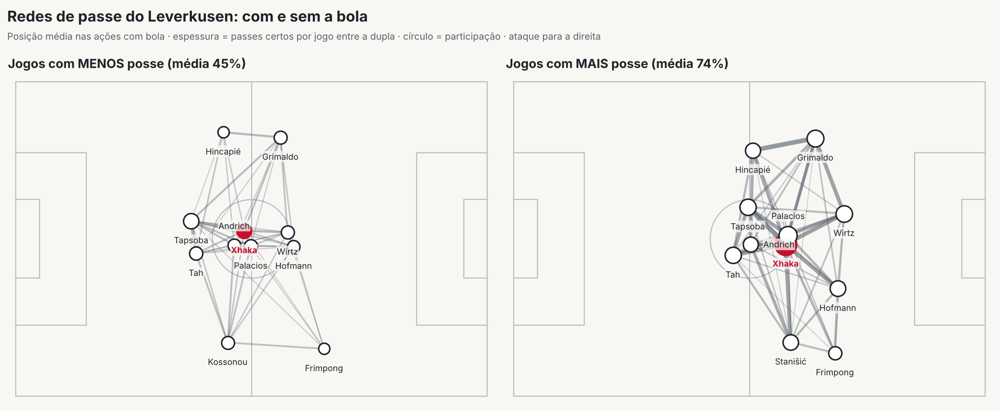

# ⚽ Análise tática: Bayer Leverkusen 2023/24

**📄 Relatório completo: [andrecasemiro28.github.io/leverkusen-analise-tatica](https://andrecasemiro28.github.io/leverkusen-analise-tatica/)**

> Como o time de Xabi Alonso terminou a Bundesliga **invicto**? Uma análise com **dados de evento e 360** da StatsBomb dos 34 jogos da temporada.



## Principal conclusão

O Leverkusen tinha **dois modos de jogo**:

| | Jogos com mais posse (74%) | Jogos com menos posse (45%, todos contra o Top 6) |
|---|---|---|
| Passes por posse | 10,4 | 5,9 |
| Velocidade até o chute | 0,8 m/s | **2,0 m/s** |
| PPDA (menor = mais pressão) | **11,6** | 23,7 |
| Contrapressão (recupera em 5 s) | **18,9%** (adv. 8,4%) | 13,6% (adv. 14,9%) |
| Altura média das recuperações | **59 m** | 46 m |
| xG a favor x contra | **2,12 x 0,44** | 1,37 x **1,54** |

- Contra os grandes, a linha defensiva ficava **6 a 8 metros mais baixa**, mesmo com a bola na mesma zona do campo (dados 360). O recuo era **intencional**.
- Nesses jogos o Leverkusen **foi superado em xG** e não perdeu nenhum. **13 gols depois dos 85 minutos valeram 9 pontos.**

## O que tem no projeto

| Etapa | Análise | Técnicas |
|---|---|---|
| Com a bola | Redes de passe, estilo de construção, papel do Xhaka | Grafos de passe, passes progressivos, velocidade de ataque |
| Sem a bola | Contrapressão e mapa de recuperações | Perdas e recuperações em até 5 s, zonas do campo |
| Forma (360) | Altura da linha defensiva | Freeze frames, controle pela zona da bola, correlação |
| Contexto | Placar e minutos finais | Estado do placar evento a evento, pontos ganhos após os 85' |

## Como rodar

```bash
git clone https://github.com/andrecasemiro28/leverkusen-analise-tatica.git
cd leverkusen-analise-tatica
pip install -r requirements.txt
python -m src.run_all      # baixa os dados (~380 MB, 1x), calcula as métricas e gera os gráficos
quarto render report/index.qmd   # opcional: refaz o relatório em docs/
```

## Estrutura

```
├── docs/                  # relatório publicado (GitHub Pages)
├── report/index.qmd       # fonte do relatório (Quarto)
├── data/processed/        # tabelas geradas (jogos, contrapressão, linha defensiva...)
├── reports/figures/       # gráficos
└── src/
    ├── data.py            # download com cache e tabela de jogos
    ├── metrics.py         # posse, xG, PPDA, field tilt por jogo
    ├── with_ball.py       # redes de passe, estilo de construção, perfil de jogador
    ├── without_ball.py    # contrapressão e recuperações
    ├── shape.py           # altura da linha defensiva (360)
    ├── game_state.py      # análise por placar e gols tardios
    ├── viz.py             # gráficos
    └── run_all.py         # executa tudo
```

## Limitações

- O Open Data só tem os jogos do Leverkusen, então a comparação é com os adversários nos mesmos jogos, e não com a média da liga.
- O 360 mostra só os jogadores visíveis na transmissão. As medidas de forma usam lances com pelo menos 8 jogadores do Leverkusen visíveis, e 3 jogos ficaram de fora.
- "Menos posse" e "adversário forte" coincidem nos mesmos jogos.

---

**Autor:** André Casemiro, estudante de Ciência de Dados e IA (IBMEC RJ) · Outros projetos: [Modelo de xG](https://github.com/andrecasemiro28/modelo-xg) · [Scouting por similaridade](https://github.com/andrecasemiro28/scouting-futebol)
Dados: StatsBomb Open Data, de uso não comercial e com atribuição.
