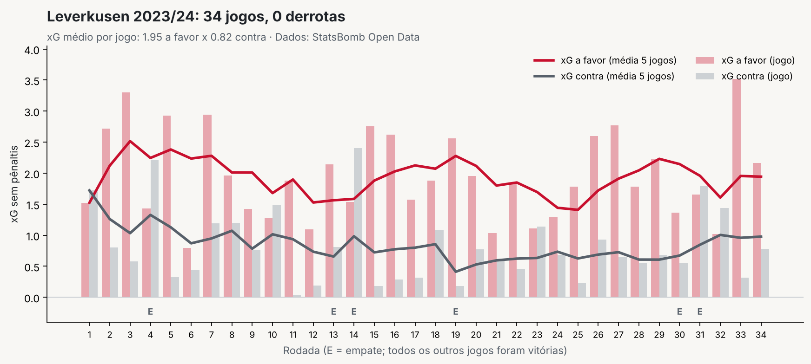
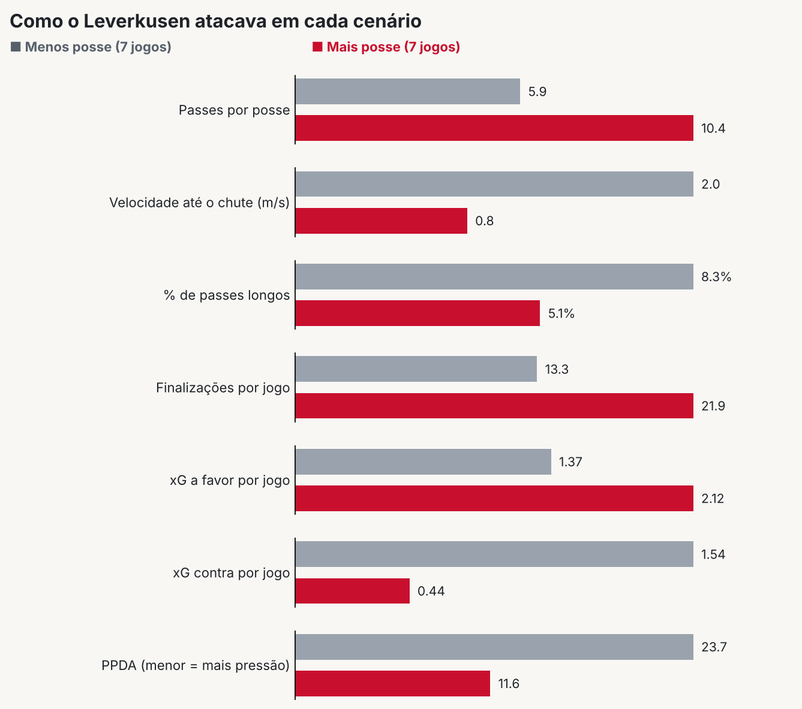
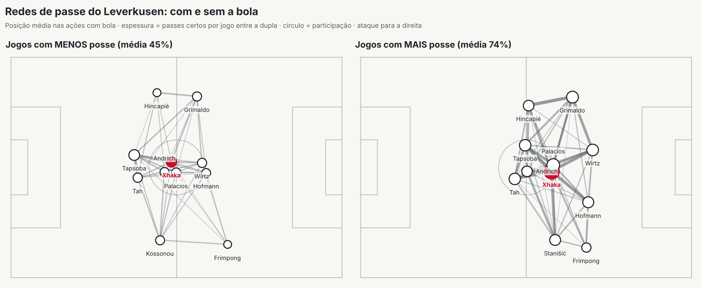
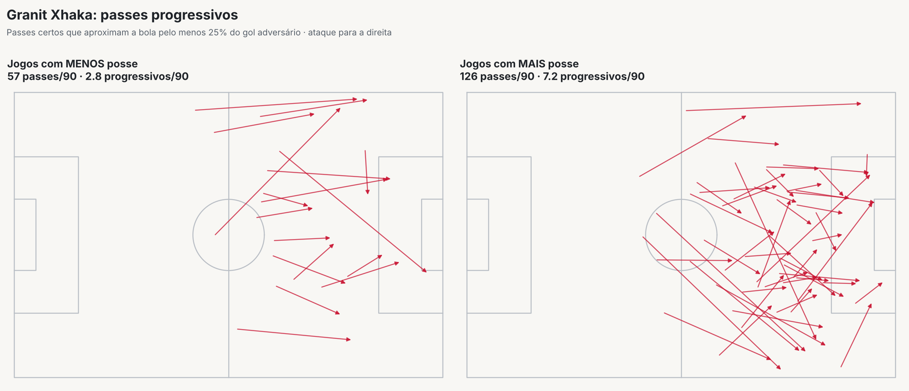
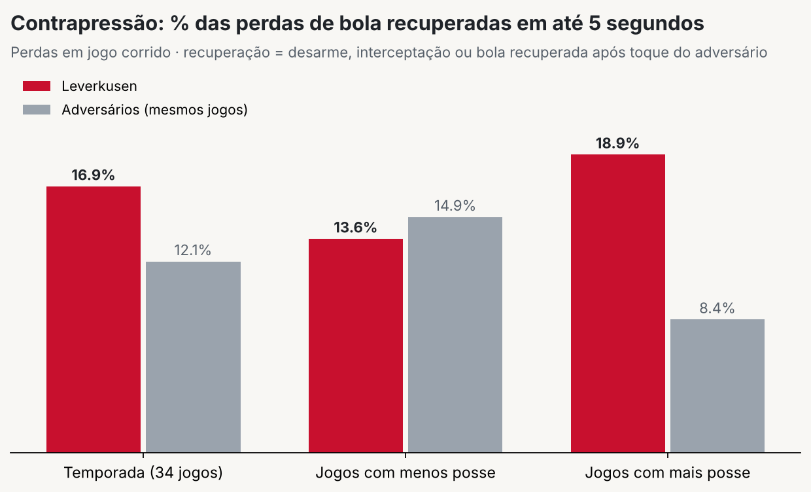
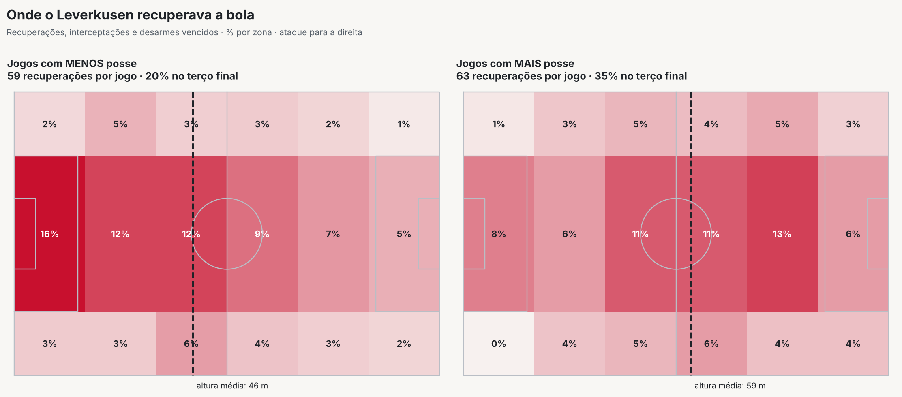
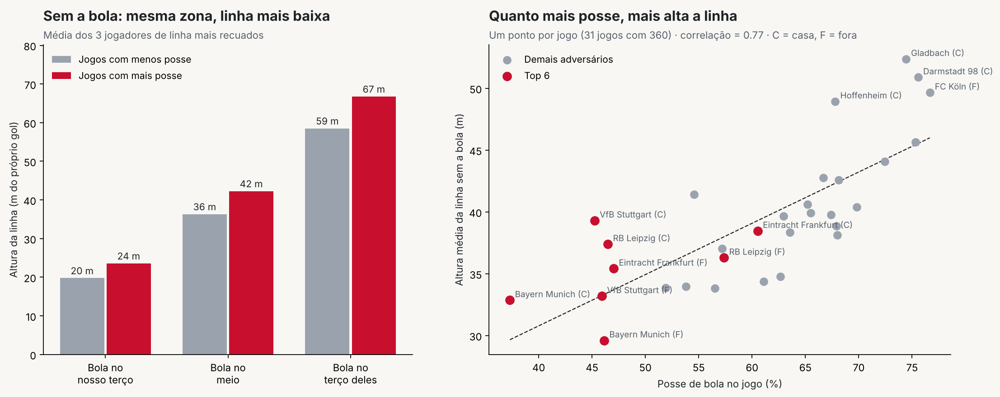
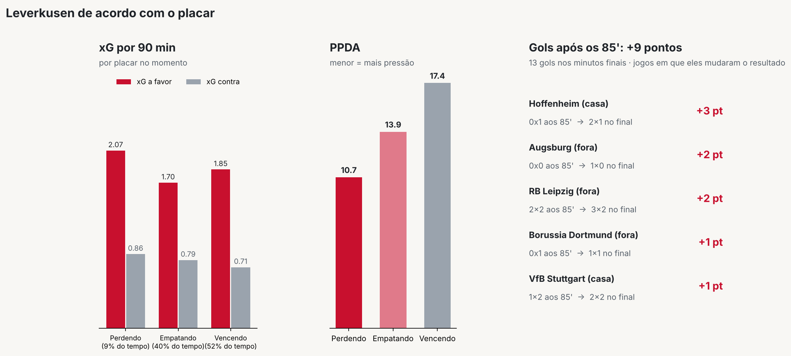

::: {.lead-box}
**Resumo.** O Leverkusen campeão invicto tinha **dois modos de jogo**. Contra a maioria dos adversários, dominava: posse alta, linha adiantada, pressão e contrapressão fortes. Contra os grandes, abria mão da bola, recuava a linha **6 a 8 metros** e atacava de forma direta. Nesses jogos o time **foi superado em xG**, e a invencibilidade dependeu de eficiência e de **gols nos minutos finais, que valeram 9 pontos**.
:::

::: {.kpis}
::: {.kpi}
<b>28V 6E 0D</b>90 pontos em 34 jogos
:::
::: {.kpi}
<b>1,95 x 0,82</b>xG por jogo, a favor x contra
:::
::: {.kpi}
<b>61%</b>posse média
:::
::: {.kpi}
<b>9%</b>do tempo perdendo no placar
:::
:::

## Dados e método

- **Fonte:** [StatsBomb Open Data](https://github.com/statsbomb/open-data), com os 34 jogos do Leverkusen na Bundesliga 2023/24.
- **Eventos:** cerca de 81 mil ações do Leverkusen (passes, conduções, pressões, desarmes, finalizações) com coordenadas.
- **360 (freeze frame):** posição dos jogadores visíveis na transmissão a cada evento. Está disponível e consistente em 31 dos 34 jogos (os dois contra o Dortmund e o jogo em casa contra o Wolfsburg ficaram fora das análises de posicionamento).
- **Comparação:** o Open Data só tem os jogos do Leverkusen, não a liga inteira. Por isso o Leverkusen é comparado com **os adversários nos mesmos jogos**, e com ele mesmo em cenários diferentes.

Para comparar cenários, separei os **7 jogos com menos posse** (média de 45%, todos contra o Top 6: Bayern 2x, Stuttgart 2x, Leipzig, Frankfurt e Dortmund) e os **7 jogos com mais posse** (média de 74%).

## A temporada

O domínio foi consistente ao longo do ano: o xG a favor ficou sempre acima do xG contra na média móvel de 5 jogos. Dos 6 empates, 5 foram contra o Top 6 (Dortmund e Stuttgart duas vezes, Bayern uma), exatamente onde o xG contra sobe. O outro foi o 0 x 0 com o Gladbach.

## 1. Com a bola: dois times diferentes

Com pouca posse, o Leverkusen era **direto**: 5,9 passes por posse, ataques **2,5 vezes mais rápidos** até a finalização (2,0 m/s contra 0,8 m/s) e mais bolas longas. Com muita posse, era **paciente**, com 10,4 passes por posse e 22 finalizações por jogo.

O dado mais importante está no meio do gráfico: **nos jogos com menos posse, o Leverkusen criou 1,37 de xG e cedeu 1,54**. Mesmo assim não perdeu nenhum desses 7 jogos (3 vitórias e 4 empates).

Com a bola, a linha de três zagueiros sobe até o meio-campo e os alas (Grimaldo e Frimpong) jogam como pontas. A conexão mais forte é o lado esquerdo: **Hincapié, Grimaldo e Wirtz**. Com menos posse, o time fica mais curto e mais recuado, com o meio-campo concentrado perto do círculo central.

### O papel de Granit Xhaka

Xhaka era o termômetro do time. Nos jogos de domínio, chegou a **126 passes por 90 minutos** (15% de todos os passes do Leverkusen), com 7,2 passes progressivos por 90, jogando cerca de 10 metros mais à frente. Contra os grandes, cai para 57 passes e 2,8 progressivos, e os poucos passes para frente viram **inversões longas para os alas**.

## 2. Sem a bola: pressão sob medida

Na temporada, o Leverkusen recuperou **16,9% das bolas perdidas em até 5 segundos**, contra 12,1% dos adversários, e foi melhor nesse indicador em 24 dos 34 jogos. Nos jogos de domínio a diferença é enorme (18,9% contra 8,4%). Contra os grandes ela some e se inverte: **13,6% contra 14,9%**.

O mesmo padrão aparece em **onde** o time recuperava a bola. Nos jogos de domínio, a recuperação média acontecia a **59 metros do próprio gol**, com 35% das bolas ganhas no terço final. Contra os grandes, a altura média cai para **46 metros**, e a zona com mais recuperações passa a ser a **própria área**.

## 3. A forma do time: a altura da linha (360)

Com os dados 360, medi a distância ao próprio gol dos 3 jogadores de linha mais recuados do Leverkusen em mais de 71 mil lances.

A pergunta-chave é se a linha baixa contra os grandes era **escolha** ou só **consequência** de ter menos a bola. Comparando lances com a bola **na mesma zona do campo**, a linha ficava **6 a 8 metros mais baixa** nos jogos com menos posse (59 m contra 67 m com a bola no campo de ataque). Ou seja, o recuo era deliberado. Entre os jogos, a correlação entre posse e altura da linha sem a bola é de **0,77**, e as duas linhas mais baixas da temporada foram contra o Bayern.

## 4. O placar e os minutos finais

- O Leverkusen ficou **perdendo só 9% do tempo** na temporada.
- **Perdendo**, pressionava como nunca (PPDA de 10,7) e criava mais (2,07 de xG por 90). **Vencendo**, aliviava a pressão (PPDA de 17,4) e controlava o jogo, cedendo o menor xG.
- Contra o Top 6, o momento mais perigoso era o **empate**: o time cedia mais xG do que criava (1,43 contra 1,34 por 90).
- **13 gols depois dos 85 minutos valeram 9 pontos**, e em 5 jogos mudaram o resultado. Sem eles o time teria 81 pontos e **três derrotas** (Hoffenheim, Dortmund fora e Stuttgart em casa), mas ainda seria campeão com folga sobre o Stuttgart (73).

## Conclusões

1. **Dois modos de jogo.** Contra a maioria, domínio: posse, linha alta, pressão e contrapressão. Contra os grandes, um bloco médio-baixo com ataques diretos.
2. **A mudança era intencional.** A linha ficava mais baixa mesmo com a bola na mesma zona do campo, e a pressão se ajustava ao adversário e ao placar.
3. **Invicto, mas não imbatível.** Nos jogos contra os grandes, o adversário criou mais. A campanha perfeita dependeu também de eficiência e da força mental para decidir nos minutos finais.

## Limitações

- O Open Data **só tem os jogos do Leverkusen**: não dá para comparar com a média da liga, apenas com os adversários nos mesmos jogos.
- O 360 mostra só os jogadores **visíveis na transmissão**. As medidas de forma usam apenas lances com pelo menos 8 jogadores do Leverkusen visíveis, e 3 jogos ficaram de fora por inconsistência dos arquivos.
- "Menos posse" e "adversário forte" aconteceram nos mesmos jogos. Parte das diferenças vem do adversário, e não só de uma escolha do Leverkusen.
- O PPDA usa desarmes, interceptações, faltas e duelos perdidos como ações defensivas. Os valores não são diretamente comparáveis com os de outros provedores.

---

**Código e dados:** [github.com/andrecasemiro28/leverkusen-analise-tatica](https://github.com/andrecasemiro28/leverkusen-analise-tatica) · **Outros projetos:** [Modelo de xG](https://github.com/andrecasemiro28/modelo-xg) · [Scouting por similaridade](https://github.com/andrecasemiro28/scouting-futebol)

*Dados: StatsBomb Open Data, de uso não comercial e com atribuição.*
